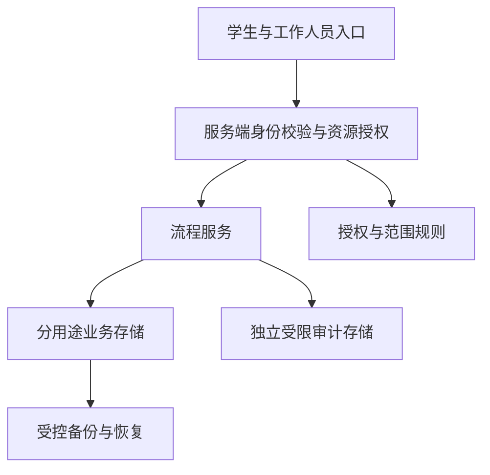

# 数据与权限架构（设计目标）

本页描述后续系统的候选架构；当前静态页面没有实现这些能力，不构成已经安全或合规的承诺。

## 建议的服务边界

所有读写、搜索、统计和导出都由服务端校验“账号、角色、资源范围、目的、授权有效期”。隐藏页面按钮、切换角色、给数据打码都不能替代授权校验。部署位置与处理责任由实施方确定；公开原型不提供真实业务托管。

## 数据最小集

| 分区 | 候选内容 | 约束 |
| --- | --- | --- |
| 自用核对 | 无身份关联的当前页面选择 | 默认不上传，不和协作台账串联 |
| 协作任务 | 内部任务标识、责任岗位、流程状态、必要时间点 | 不使用健康标签排序；不能把标识误称匿名数据 |
| 必要沟通记录 | 授权范围内的事实与约定动作 | 不默认采集诊断、量表、家庭详情或完整自由文本 |
| 身份映射 | 最少的账号与工作范围映射 | 与业务内容分离；映射可还原则仍可识别 |
| 审计 | 操作人、操作、资源引用、时间、授权事由 | 不记录核对答案、正文、凭证或访问令牌 |

保留期限、删除规则、撤回对已处理记录的影响、备份清理和审计保留应分别约定，不以“留痕”为理由无限期保存。

## 候选权限矩阵

| 角色 | 最小权限 | 默认限制 |
| --- | --- | --- |
| 学生本人 | 自己的求助进度与可公开说明 | 不查看他人记录 |
| 朋辈观察者 | 提交必要事实 | 不读取他人台账，不获取处理结果 |
| 辅导员 | 被分派任务的必要信息与跟进动作 | 不默认读取全部心理档案；跨班拒绝 |
| 授权专业人员 | 明确授权范围内的转介与协作 | 需要事由与审计；不是无限访问 |
| 管理岗位 | 经披露风险评估的流程聚合 | 不默认查看个体详情 |
| 运维人员 | 运行状态与受限技术日志 | 不默认读取业务明文；异常访问需受控流程 |

角色是条件之一，还需资源范围与用途授权。转班、离岗、转介、委托及紧急例外都需要单独规则；授权要限时、可撤销、可审计。运维拥有机器管理权时仍存在明文访问风险，需设计密钥隔离、双人授权与审计，不能靠“管理员看不到”一句话解决。

## 上线前需实现

- 身份认证、会话管理、服务端资源授权以及越权测试。
- 传输与存储保护、密钥管理、受控导出、备份恢复验证。
- 请求限流、输入校验、输出编码以及审计完整性保护。
- 去标识化与匿名化的区别；小样本抑制只是措施之一，不是匿名化证明。
- 对紧急求助提供由实施方维护的人工处理入口，不能依赖关键词、模型或异步任务作为唯一渠道。

当前版本没有 AI 模型。未来若评估模型辅助，应先明确必要性、错误处理、人类复核、数据流向与供应方责任，不以模型建议替代专业判断。
