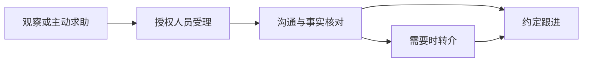

# 产品设计与验收目标

## 定位

项目关注两类流程问题：评价时缺少必要的背景核对，关怀协作时缺少明确的下一步。设计目标是提高流程可解释性与可追溯性，不给个人打健康分、贴标签或生成处分依据。

## 心盾：记录与结论分开

1. 用户自愿查看填表前核对项目，可以跳过或退出。
2. 四项示例关注休息、进食、身体感受与心情；正式字段仍需独立论证。
3. 所有项目完成后，演示以“两项需要留意”为示例提示条件。
4. 触发时建议保留事实、稍后复核；未触发时只说明示例规则没有触发，不能解释为健康正常或评价有效。
5. 提示不得阻止记录，不得进入成绩、评优、排名或奖惩。

该阈值只为展示交互，不是测评工具。公开原型不记录身份，不保存核对结果，不接入研究问卷。

## 心桥：协作闭环

演示按固定虚构案例解释各环节，并未实现记录提交、消息通知或真实转介。朋辈入口仅呈现观察上报指引，不显示他人记录或处置结果。学生自己的求助记录与朋辈上报权限应分别设计。

v0.2.0 增加内存中的可交互任务：学生发起 → 辅导员受理 → 沟通 → 转介 → 专业人员接收 → 完成跟进；另可在沟通后直接跟进。重复、越序与不匹配演示角色的操作被规则拒绝。这里的动作限制用于说明设计，所有数据仍在同一个浏览器页面内，不能当作生产权限控制。学生视角只显示自己的进度摘要；朋辈视角不显示该任务的状态、负责人或操作记录。

心盾增加固定虚构案例的三步复核练习，保留事实、暂时判断与修订过程。未完成核对也可以做练习。实际参与者体验安排和空白记录见 [可用性验证](usability.md)。

## 目标验收标准（后续实现）

| 场景 | 可验收行为 |
| --- | --- |
| 用户未填完核对 | 不显示完整规则结论，明确未完成 |
| 用户想退出 | 可以无条件退出演示并清除当前选择 |
| 未触发规则 | 不显示“健康正常”“通过评估”等结论 |
| 朋辈访问 | 服务端拒绝读取他人记录与处理结果 |
| 跨班调阅 | 没有明确授权时，服务端拒绝并记录访问事件 |
| 授权变化 | 撤销授权后，已有会话与后续请求同步失效 |
| 跟进结束 | 记录必要的过程状态，不生成永久个人标签 |
| 聚合统计 | 同时考虑小样本、差分查询、交叉筛选与重复发布的识别风险 |

## 验证方法

先用虚构案例开展可用性测试：用户是否能理解“待复核”，是否知道谁负责下一步，是否误把角色切换当成安全保护。指标可包括任务完成率、误解次数、待办是否遗漏等；不虚构试点人数、准确率、心理健康改善效果或研究结论。
